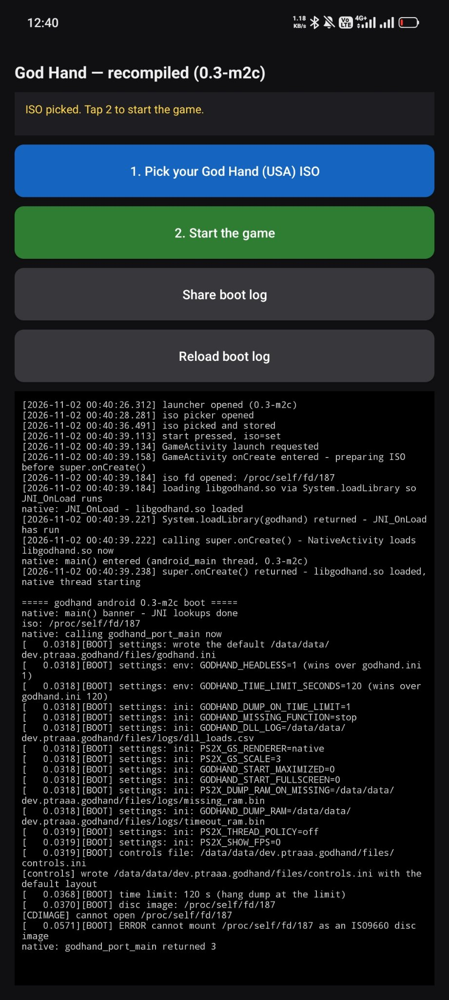
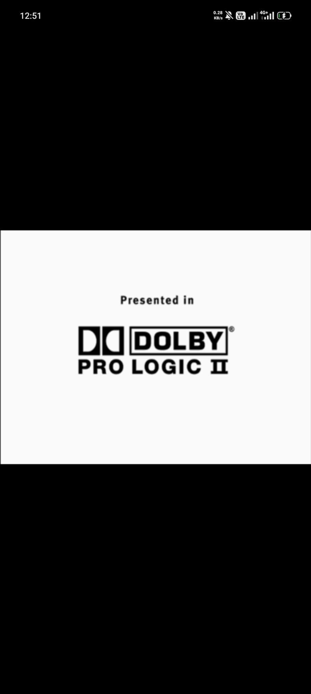
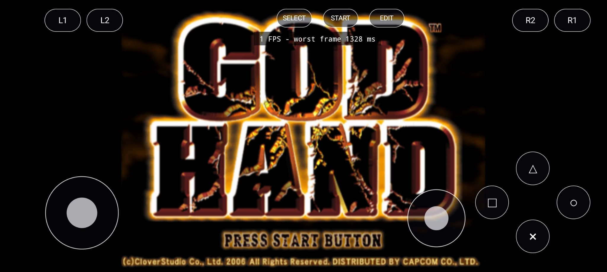
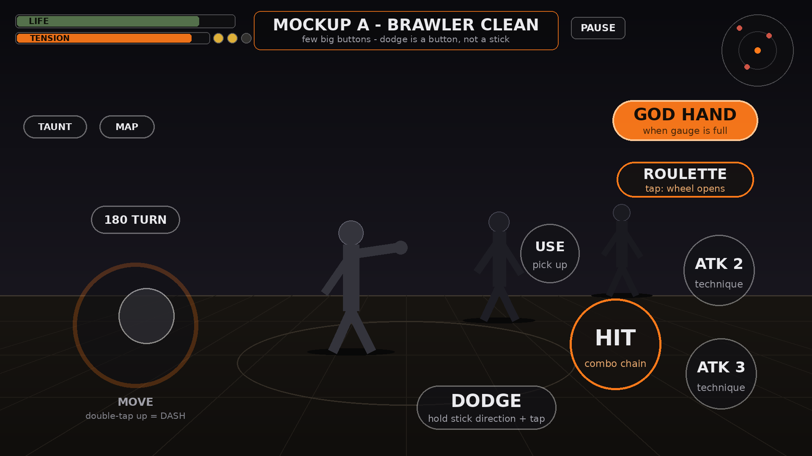
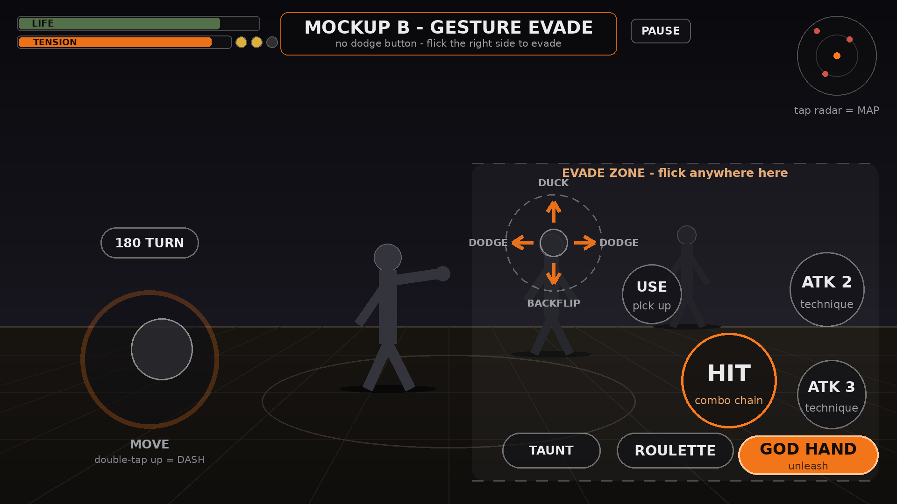
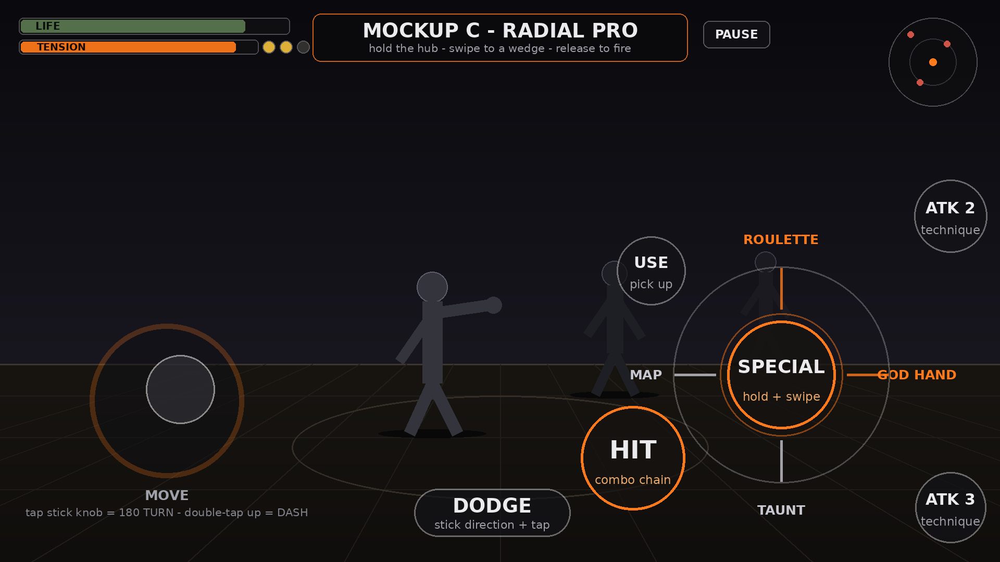

# Progress log — from first boot to a playable phone build

The whole run, start to current state, with the numbers the phone actually produced. Device for everything: POCO F5 (Snapdragon 7+ Gen 2, Adreno 725), my only phone. Disc: my own US copy of God Hand (SLUS-21503), hash-verified by the app on every install. The detailed engineering reports for every step live in [docs/milestones](milestones/) — this page is the story they tell.

## Chapter 1 — the game becomes one program

The recompilation toolchain translates the PS2 program into native code ahead of time. For God Hand that is 10,554 functions in the main program plus 81 overlay modules, generated from about 9 MB of the disc (the boot program, the file table and the overlays — not the 1.57 GB image). The translated code, the runtime and the game layer link into a single program: the translation proof held, whole, on the first full build.

## Chapter 2 — a shell, and the first picture

The Android shell came next: a launcher that picks the disc image from phone storage, a game activity, touch controls with an editable layout, gamepad support, and settings that persist — the sealed-build behaviour of choices silently resetting is the specific thing this shell exists to not do.

The early builds failed honestly. This is the 0.3 launcher with a boot that died at mounting the disc image:



The breakthrough was build 0.4: the disc mounted, the boot program and its modules loaded, the sound stack came up, and the game produced its first real picture on the phone — the Dolby Pro Logic II splash from the intro sequence.



From there the shell grew teeth: landscape fullscreen, a touch overlay in its own window (the first version was invisible — window layering), a settings page (resolution scale, FPS counter, thread policy, vsync, overlay opacity and size), a layout editor and button remapping. The game booted to its title screen and sat there at **1 FPS, worst frame 1,328 ms**.



## Chapter 3 — measuring instead of guessing

The 1 FPS title started a long audit, and the audit's first lesson was humility: its prime suspect (a boot-time disc prefetch saturating storage) turned out to be innocent — the prefetch had been disabled in the glue since the first builds and never ran. The replacement disc cache (asynchronous, background worker) did cure the streaming scenes: the Sofdec/ADX logo sequence went from 4 FPS to 60 FPS between builds 0.6 and 0.8. But the title did not move.

So the present path got split into timed buckets — sync, gs-fetch, draw, swap — printed every five seconds. The verdict, at the title screen:

```
[frame-split] presents=7 avg 761.8 ms fields +282 | sync 0.00 ms (0%) gs-fetch 760.66 ms (100%) draw 0.19 ms (0%) swap 0.85 ms (0%)
```

gs-fetch — the leg where the CPU renderer fetches and presents the finished GS frame — ate 99-100% of every frame. Everything else was measured and acquitted: the emulation fields kept advancing, the IOP chip idled at 12-29%, the music stream never starved, and the resolution scale setting turned out to be a no-op on the CPU backend (it always rendered at native 640x448). The CPU renderer was a dead end for speed, however correct its pictures were.


## Chapter 4 — building the GPU renderer Android never had

The port already contained a GPU renderer, some 5,800 lines — but its graphics context existed only for Windows. On any other platform it returned an error and latched off. Build 0.11 turned the port's own GPU switch into a launcher toggle and proved the prize on the phone: with the fetch leg bypassed, the machine ran empty presents at 16.7-18.9 ms, about 60 a second. The pipe was fast; only the drawing was missing.

0.12 built the Android door: an EGL OpenGL ES 3.2 context owned by the graphics layer itself (this backend renders into buffers and hands back pixels, it never draws to the window, so its context lives on a small private surface), and a load-time translation of the desktop shaders from `#version 460 core` to `#version 320 es` — all nine shaders pass a real GLSL validator after translation. First run on the phone: 57 FPS, completely black screen.


The log named the wall in one line — `missing GL functions: glGetBufferSubData, glGetQueryObjectui64v, glQueryCounter` — and tracing it found the rude part: every EGL step had already succeeded on the phone, then the function-table check destroyed the working context and latched the backend off for the session. 0.13 resolved the three the ES way (the buffer read is real data path and got a map-based implementation; the timer queries bind their genuine EXT entry points on this driver, with safe fallbacks), and made every failure in the backend print its reason out loud.

The 0.13 boot chain, verbatim from the phone:

```
[gs-gpu] ES entry points: glGetBufferSubData = map shim (no ES entry point exists); timer queries = GL_EXT_disjoint_timer_query (glQueryCounterEXT / glGetQueryObjectui64vEXT)
[gs-gpu] EGL context created: OpenGL ES 3.2 ... | Adreno (TM) 725 | max SSBO bindings 64, max SSBO block 134217728 bytes, EXT_buffer_storage yes
[gs-gpu] shader compile summary: 9 compiled, 0 failed
[frame-split] presents=300 avg 16.7 ms fields +300 | sync 11.68 ms (70%) gs-fetch 3.96 ms (24%) draw 0.21 ms (1%) swap 0.78 ms (5%)
```

Title and menus: a real 60 FPS, drawn by the GPU. And the game world itself renders through the new renderer:


## Chapter 5 — the current wall

In-game, the guest completes only about 8-16 fields per 5-second window (menus: ~300), while the host waits in sync and re-presents near-identical frames. The counter reads 19-20 FPS; the world moves at 1-3 new frames a second. It looks frozen, and saying so plainly matters more than the counter.

The standing suspects are the per-field graphics work under real scene load: synchronous texture readbacks (each one can drain the whole GPU pipeline) and the compute rasterizer's throughput. The next build instruments the backend worker itself — fields, draws, raster time, readback counts and time, fence waits, worker load, per window — so the fix lands on the measured eater. That is the same method that found every wall so far: the disc cache, the fetch leg, the function table. Measure, then fix the thing that is actually slow.

## Chapter 6 — ARUS, the bridge, and the call-count era

The renderer story did not end with the home GPU backend. First came ARUS (0.23-m22), the adaptive GS pipeline: upload dedup, 2x2 block shading, async deferred readbacks and a bounded queue depth, under one master switch. Then the bigger bet — Path B: instead of growing the home renderer forever, bridge the PCSX2 graphics core itself onto Vulkan/Android and let a mature GS do the drawing. Eight bridge iterations (b1-b8) later it was the main renderer. A native-renderer experiment (m25) was measured on the phone, found worse — fence stalls of seconds, not milliseconds — and reverted without ceremony; m26 revived the best bridge recipe, m27 worked on the graphics pipeline.

Then the long middle: m28 to m38 attacked the cost of the work itself. VU work joining, vblank scheduling, callback diets, a funnel fix, residency tuning (measured, then honestly closed after m37), and finally train merging in m38 — fewer, larger invocations of the graphics machinery instead of hundreds of small ones per field. Crowds climbed step by step: by m30, crowded scenes ran at roughly 42-58 fields per second where they had been 31-51. Every build was device-tested on the same phone, and every verdict is in the reports below, including the unflattering ones.

m38's verdict was still "very laggy in crowds, sound choppy" — so m39 started from research instead of another guess: forum and emulator-community findings on PS2 audio stutter and God Hand settings, checked against this codebase one by one. What landed (0.40-m39): an async, non-blocking 48 kHz audio feed with a ~50 ms queue and the time-stretch bypassed; GS hardware readbacks switched off through a new bridge option (the control existed inside the PCSX2 config all along but was unreachable from this port); minimum blending; and the cheapest SPU2 mode (nearest interpolation, reverb off). Every one of those sits behind its own switch in the settings file, and the renderer stays forced to the bridge build so a stale settings file cannot poison the test. The same build rebuilt the app itself: native Android buttons (with a D-pad and L3/R3 the old overlay never had), a redesigned ready-to-play launcher, and an original fist icon.

Device verdict on m39, in my own words from the test: really good. Performance clearly better; sound better too, about 80% of the way there. Not a victory lap — a new baseline.

## Chapter 7 — where it stands, the controls rethink, and the first public release

The game is playable on the reference phone, and as of today it is public: v0.43-m42 is out on the releases page as a pre-release, and the project is open to contributors. Playable but still unstable is the honest label — busy areas still drop frames and the sound is still being pushed from ~80% to all the way. The standing fronts stay sound and crowd performance; they are now open fronts, worked in the open.

m40 took on the last emulator habit left in the app: the controls. A full PS2 pad cloned onto a touchscreen is too much — two sticks, a D-pad, four shoulders, buttons a phone fight never gives your thumbs time to find. So the controls were redesigned the way a native Android brawler would design them, in three styles the player picks between:

- **Brawler Clean** — one move stick, a few big fixed fight buttons, dodge as a big pill whose direction follows the stick.
- **Gesture Evade** — no dodge button and no right stick at all; flick the right side of the screen to dodge.
- **Radial Pro** — fixed fight buttons plus one special hub: hold, swipe to a wedge, release, for roulette and the God Hand unleash.







All three shipped in m40 as a player-selectable control style — what fits one player's thumbs is not what fits another's, so the choice sits in the settings instead of being made for them. The same build added the Player mode / Developer mode setting: Player mode is the clean, player-facing app; Developer mode shows the boot log and the technical surfaces. Player is the default.

The full mapping tables — every PS2 function and where it lives in each style — are in [CONTROLS-DESIGN.md](CONTROLS-DESIGN.md). One design fact worth stating: God Hand has no guard button; defence on the PS2 was the right-stick dodge system, so in every style here the dodge gets the prominence, not an invented guard.

Two smaller builds followed in the same day. m41 replaced the tiny pause pill in every style with one proper START button — players skip cutscenes with Start, so it cannot be an afterthought in a corner — and set the shipped defaults to the best known values: widescreen on, resolution at 1x, everything else audited and kept where the measurements put it. Defaults are fallbacks only; a saved choice always wins. m42 then made Player mode mean performance too: thread placement and disc prefetch switch on automatically at game start for the player (the stored Developer toggles are never rewritten — flip back to Developer and your own values rule again), and the move stick learned the run: push it fully forward and the character dashes on its own, the double flick synthesized once, no second flick from the player.

That is the build that ships today. It was also this morning's test build on my own phone: the launcher reads Player mode, Brawler Clean, widescreen on, and the game boots to the title and plays with the new START button where a thumb expects it.

The first public bug report arrived the same day: on a Dimensity 8050 (Mali GPU) the game ran and the sound played, but the screen stayed black — the main Vulkan renderer could not open on that GPU, and the app had no backup plan. m44, out the next day (2026-11-12), is the answer: if the main renderer cannot start, the game switches itself to the built-in renderer in the same session and a picture appears, and the boot log now names the GPU it found. Whether the fallback fires correctly on a real Mali phone is, at the time of writing, awaiting the field reports this release asks for.

The second public report (issue #3) came from the opposite direction: a player picked a modded ISO — an "Uncensor" patch — pressed start, and got a silent dead screen. The port had done its job exactly right: the disc check refused the image, because the recompiled code is built from the original SLUS-21503 executable and only that executable may boot. But the only place the reason existed was the boot log, so to the player it looked like the game simply did not open. m45, out the same day (2026-11-12), closes that gap without touching the refusal: the disc check now classifies why it refused, the glue records it, and the app shows a plain message on screen — this image is not the original release; please use a clean dump of the original US disc — with one OK button back to the launcher. The same message family covers wrong-region and otherwise non-original images, files that cannot be read as a disc image, and, generically, any other failed start. At the time of writing the build is verified in its shipped artifacts and awaiting its first on-device run.

Then the direction itself changed. The bridge — a desktop-class graphics core — had won its place honestly, on measurements, but its ceiling kept being the wall: desktop assumptions, a refusal to open at all on some mobile GPUs (that was the m44 bug), and no way for a one-person project to fix a bottleneck inside somebody else's engine. The native renderer is the opposite: ours, written for mobile chips, with every bottleneck in it openable. Stage 2, the native-main-path campaign, scopes that reversal in full (the scope document is in the reports list below), and its first build, m47 — the flip, and nothing else — was built the same day (2026-11-12) as an internal testing build: the compiled-in renderer seed resolves native, and the GPU renderer toggle — which used to default off, so a fresh install's "native" quietly meant the CPU backend — defaults on, with saved choices still read back exactly as stored. It was briefly published and then taken down the same day: the native path is not stable enough to be the public build yet, so m47 stays internal and the public build remains m45. Inside the project it is a baseline instrument by design: Developer-mode boot logs from two-to-three-minute fights are the numbers the campaign's next rounds plan against. Whether the native figures come back better or worse than the bridge's is the question m47 exists to answer.

## The reports

Every step above has a full engineering report, published as written at the time, wrong turns included:

- [SPIKE](milestones/SPIKE.md) · [EXTRACTOR](milestones/EXTRACTOR.md) · [GENERATION](milestones/GENERATION.md) — the toolchain and generation groundwork
- [M1A](milestones/M1A.md) · [M2A](milestones/M2A.md) · [M2B](milestones/M2B.md) · [M2C](milestones/M2C.md) — translation proof and the first Android builds
- [M3](milestones/M3.md) · [M4](milestones/M4.md) · [M5](milestones/M5.md) — shell, controls, settings
- [AUDIT-M6](milestones/AUDIT-M6.md) · [M6](milestones/M6.md) · [M7](milestones/M7.md) · [M8](milestones/M8.md) — the cache, the audit, the acquitted suspects
- [M9](milestones/M9.md) — the frame-split verdict on the CPU renderer
- [M10](milestones/M10.md) · [M11](milestones/M11.md) · [M12](milestones/M12.md) — the GPU toggle, the EGL bring-up, the function-table wall
- [M13](milestones/M13.md) · [M14](milestones/M14.md) · [M15](milestones/M15.md) · [M16](milestones/M16.md) — the renderer measured scene by scene
- [M17](milestones/M17.md) · [M18](milestones/M18.md) · [M19](milestones/M19.md) — input and presentation work on the road to ARUS
- [M20](milestones/M20.md) · [M21](milestones/M21.md) · [M22](milestones/M22.md) · [M23](milestones/M23.md) · [M24-GPU-COST](milestones/M24-GPU-COST.md) — ARUS 1.0 and the GPU cost audit
- [PATH-B-SPIKE](milestones/PATH-B-SPIKE.md) · [PATH-B-B1](milestones/PATH-B-B1.md) · [PATH-B-B1B](milestones/PATH-B-B1B.md) · [PATH-B-B2](milestones/PATH-B-B2.md) · [PATH-B-B3](milestones/PATH-B-B3.md) · [PATH-B-B4](milestones/PATH-B-B4.md) · [PATH-B-B5](milestones/PATH-B-B5.md) · [PATH-B-B6](milestones/PATH-B-B6.md) · [PATH-B-B7](milestones/PATH-B-B7.md) · [PATH-BRIDGE-PIPELINE](milestones/PATH-BRIDGE-PIPELINE.md) — the PCSX2 GS bridge, spike through b7 and the pipeline work (the b0 scoping note is kept locally; it is mostly upstream licence archaeology)
- [PATH-B5REVIVAL](milestones/PATH-B5REVIVAL.md) · [PATH-NATIVE-M25](milestones/PATH-NATIVE-M25.md) — the b5 revival (m26) and the native-renderer experiment that was measured and reverted (m25)
- [PATH-PIPELINE-BUILD](milestones/PATH-PIPELINE-BUILD.md) · [PATH-VUJOIN](milestones/PATH-VUJOIN.md) · [PATH-VUJOIN-BUILD](milestones/PATH-VUJOIN-BUILD.md) · [PATH-VUJOIN2-BUILD](milestones/PATH-VUJOIN2-BUILD.md) · [M27-LOG-ANALYSIS](milestones/M27-LOG-ANALYSIS.md) · [M29-LOG-ANALYSIS](milestones/M29-LOG-ANALYSIS.md) — the pipeline and VU-join builds, m27-m29
- [PATH-VBLANK](milestones/PATH-VBLANK.md) · [PATH-VBLANK-BUILD](milestones/PATH-VBLANK-BUILD.md) · [M30-LOG-ANALYSIS](milestones/M30-LOG-ANALYSIS.md) · [M31-LOG-ANALYSIS](milestones/M31-LOG-ANALYSIS.md) · [PATH-PRESENT](milestones/PATH-PRESENT.md) · [PATH-PRESENT-BUILD](milestones/PATH-PRESENT-BUILD.md) — vblank scheduling and the harvest, m30-m31
- [PATH-THROUGHPUT](milestones/PATH-THROUGHPUT.md) · [PATH-THROUGHPUT-BUILD](milestones/PATH-THROUGHPUT-BUILD.md) · [M32-LOG-ANALYSIS](milestones/M32-LOG-ANALYSIS.md) · [PATH-CALLBACK-BUILD](milestones/PATH-CALLBACK-BUILD.md) · [M33-LOG-ANALYSIS](milestones/M33-LOG-ANALYSIS.md) · [CALLCOUNT-STEP0](milestones/CALLCOUNT-STEP0.md) · [PATH-STAGEPROG-STEP0](milestones/PATH-STAGEPROG-STEP0.md) · [PATH-CHARPROG-STEP0](milestones/PATH-CHARPROG-STEP0.md) — throughput, the callback diet, and the call-count step-0 gates, m32-m33
- [M34-REPORT](milestones/M34-REPORT.md) · [M35-REPORT](milestones/M35-REPORT.md) · [M36-REPORT](milestones/M36-REPORT.md) · [M37-REPORT](milestones/M37-REPORT.md) · [M38-REPORT](milestones/M38-REPORT.md) — the rider, the funnel, residency (opened and closed), and the train merge; each with its log analysis alongside in the same folder
- [M39-SHELL-REPORT](milestones/M39-SHELL-REPORT.md) · [M39-CORE-REPORT](milestones/M39-CORE-REPORT.md) · [M39-DELIVERY](milestones/M39-DELIVERY.md) — m39: native buttons and the redesign, the research-backed audio/GS fixes, and the combined delivery
- [M40-CONTROLS-REPORT](milestones/M40-CONTROLS-REPORT.md) · [M41-STARTBTN-REPORT](milestones/M41-STARTBTN-REPORT.md) · [M42-PLAYERPERF-REPORT](milestones/M42-PLAYERPERF-REPORT.md) — m40-m42: the three selectable control styles and the two modes, the real START button and the defaults audit, Player-mode automatic performance and the auto-dash
- [M44-GSFALLBACK-REPORT](milestones/M44-GSFALLBACK-REPORT.md) — m44: the first public bug report (a black screen on a MediaTek phone), the automatic graphics fallback that answers it, and the GPU name in the boot log
- [M45-BOOTMSG-REPORT](milestones/M45-BOOTMSG-REPORT.md) — m45: the second public report (issue #3 — a modded ISO refused in silence), and the in-app message that now says why the game did not start
- [STAGE2-NATIVE-MAINPATH-SCOPE](milestones/STAGE2-NATIVE-MAINPATH-SCOPE.md) · [M47-NATIVEFLIP-REPORT](milestones/M47-NATIVEFLIP-REPORT.md) — stage 2: the campaign to make the native renderer the main path again, scoped, and its first build, the flip itself

## Ground rules that have not changed

- No game data in this repo, ever. You bring your own legitimate US disc; the app verifies it by SHA-256 and refuses anything else.
- Playable now, still polishing: the current public build, m45, plays on the reference phone, with sound at roughly 80% and crowd performance still being pushed. m42 shipped 2026-11-11 as the first public pre-release, m44 followed on 2026-11-12 as a hotfix for the MediaTek black screen, and m45 followed the same day with an on-screen message for a refused disc image — playable, still unstable, labelled as both. The stage-2 native campaign is in internal testing on top of m45, and the project is open to contributors; when the state changes, this page changes.
