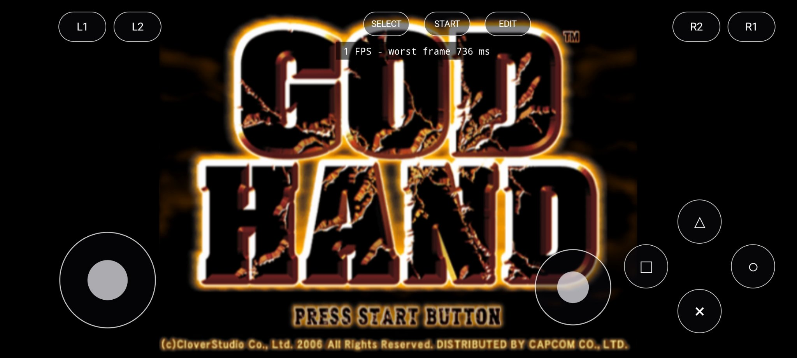
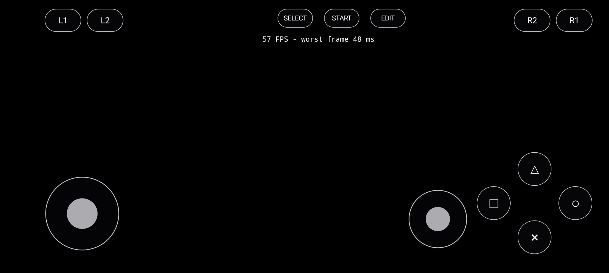
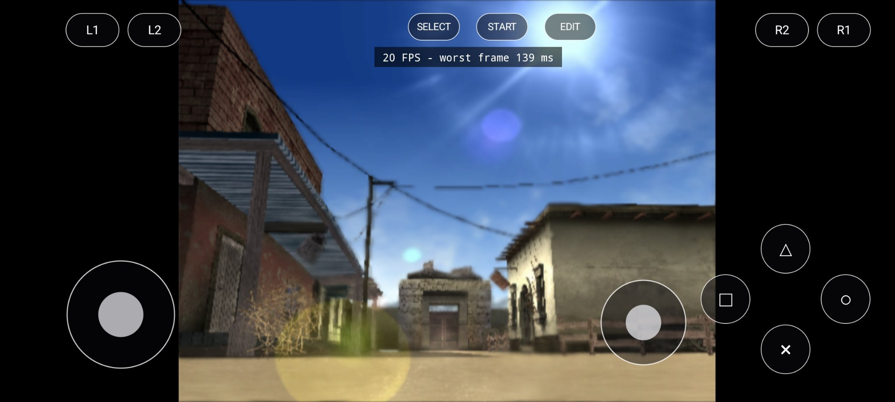
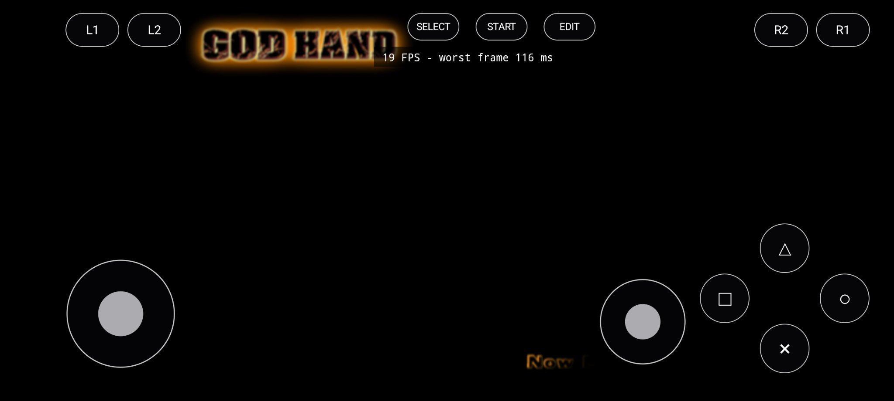

# Progress log — the GPU renderer fight

Device for everything below: POCO F5 (Snapdragon 7+ Gen 2, Adreno 725), my own phone, my own disc (US, SLUS-21503). Every number here comes out of the app's own boot log on real hardware, not from a benchmark rig.

## Where it stands (2026-11-02)

- The game boots, menus and title run at a real 60 FPS on the new GPU renderer.
- The actual 3D game world renders correctly through that GPU renderer.
- In-game it is not there yet: the world only produces about 1-3 new frames per second under real gameplay load, so it looks frozen even though the display counter shows ~20. That wall is being measured right now (see the bottom).

## How we got here

The CPU renderer drew everything from the start, but the title screen ran at 1 FPS. Instead of guessing, the present path got split into timed buckets (sync / gs-fetch / draw / swap). At the title, **gs-fetch ate 99-100% of every frame** (windows of 7-8 presents averaging 679-768 ms; draw ~0.3 ms, swap ~2 ms). The emulation cores were fine — fields kept advancing — the wall was one leg: the CPU path that fetches and presents the GS frame. Every cheaper suspect was measured and acquitted on the way: disc streaming, the IOP chip (12-29% busy at worst), thread policy, resolution scale (which turned out to be a no-op on the CPU backend — the game always rendered at native 640x448).



The port already had a GPU renderer, about 5,800 lines of it, but its context creation was implemented for Windows only. Off Windows it returned an error string and the backend latched off. Flipping it on in 0.11 proved the shape of the prize: with the fetch leg bypassed the machine ran 16.7-18.9 ms per present, about 60 a second, with an empty picture.

0.12 built the Android door for real: an EGL OpenGL ES 3.2 context owned by the GS layer (a 1x1 pbuffer — this backend renders into buffers and returns pixels by readback, it never draws to the window directly), and a load-time shader translation from desktop `#version 460 core` to `#version 320 es`. All nine shaders pass a real GLSL validator after translation. First device run: full speed, completely black screen.



The boot log named the reason in one line: `missing GL functions: glGetBufferSubData, glGetQueryObjectui64v, glQueryCounter`. Tracing it showed something almost rude — every EGL step had already succeeded on the phone, then the function-table check tore the working context down and latched the backend off for the whole session. 0.13 fixed the three functions the ES way: the buffer read got a proper map-based implementation (it is a real data path, six call sites including the present readback), the two timer queries bind their real EXT entry points when the driver advertises them (the Adreno does), and every failure latch in the backend now prints its reason instead of going silent.

The 0.13 boot chain, verbatim from the phone:

```
[gs-gpu] ES entry points: glGetBufferSubData = map shim (no ES entry point exists); timer queries = GL_EXT_disjoint_timer_query (glQueryCounterEXT / glGetQueryObjectui64vEXT)
[gs-gpu] EGL context created: OpenGL ES 3.2 ... | Adreno (TM) 725 | max SSBO bindings 64, max SSBO block 134217728 bytes, EXT_buffer_storage yes
[gs-gpu] shader compile summary: 9 compiled, 0 failed
```

And the title screen went from 1 FPS to this:

```
[frame-split] presents=300 avg 16.7 ms fields +300 | sync 11.68 ms (70%) gs-fetch 3.96 ms (24%) draw 0.21 ms (1%) swap 0.78 ms (5%)
```

## The current wall

In-game, the picture is real — this is the starting village, drawn by the GPU renderer:





But the guest only completes about 8-16 fields per 5-second window in-game (against ~300 in the menus), while the host spends 82-96% of its frame time waiting in sync and re-presenting near-identical frames. It reads 19-20 FPS on the counter and feels like 1. Something in the per-field GS work under real scene load — texture readbacks and the compute rasterizer are the two standing suspects — eats the field budget. The next build instruments the backend worker itself (draws, raster time, readback counts and time, fence waits, worker load per window) so the fix lands on the measured eater, same method that found the title wall.

## Ground rules that have not changed

- No game data in this repo, ever. The port needs your own legitimate US disc; it checks the boot file by SHA-256 and refuses anything else.
- Not playable yet. Menus are smooth, the world renders, and the in-game frame production is the open fight. When that changes, this page changes.
